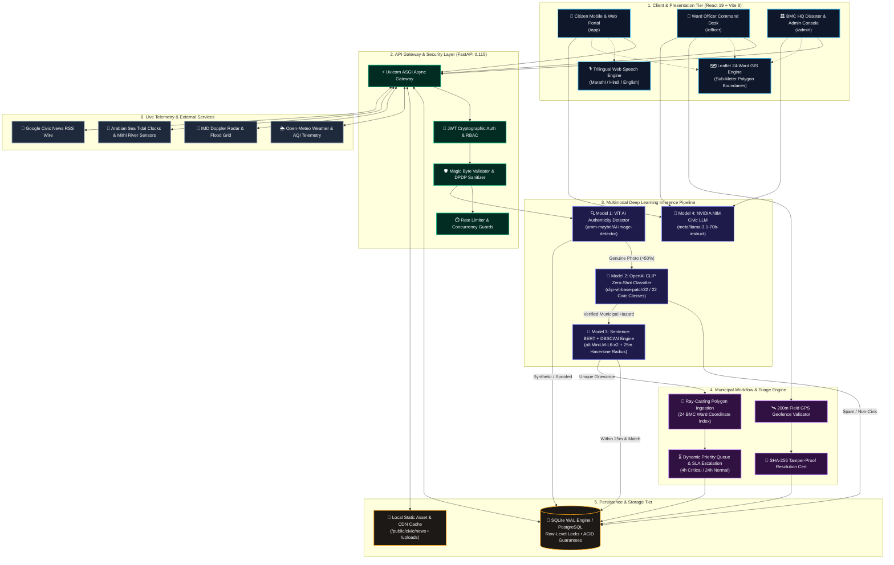
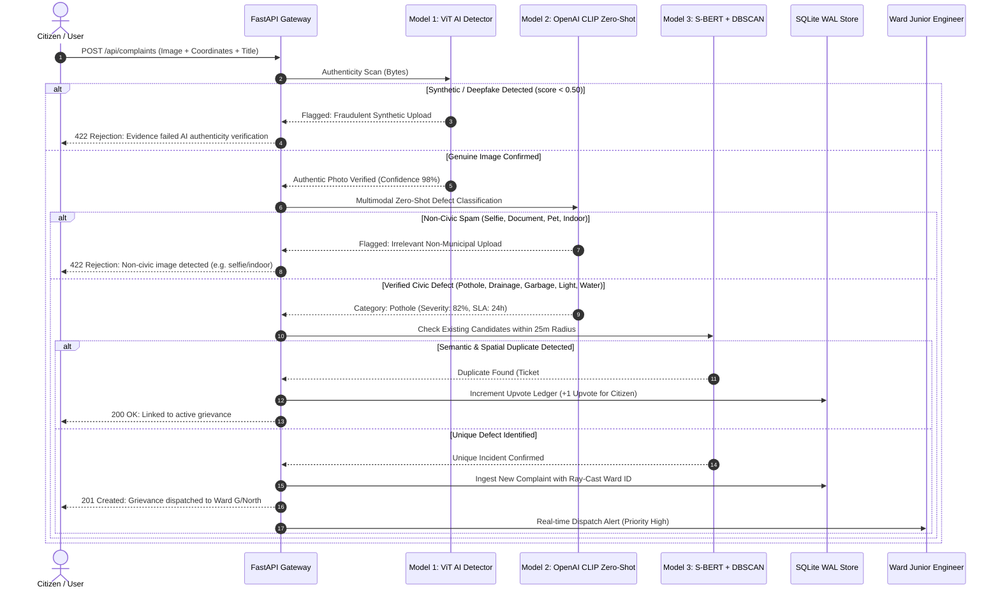
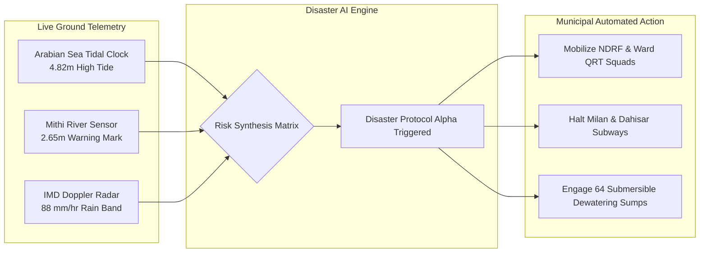

<div align="center">

# 🏛️ KAISER AI
### *Next-Generation Sovereign Civic Intelligence & Municipal Governance Platform for Greater Mumbai*

<p align="center">
  
</p>

[](https://react.dev/)
[](https://vitejs.dev/)
[](https://tailwindcss.com/)
[](https://fastapi.tiangolo.com/)
[](https://pytorch.org/)
[](https://huggingface.co/openai/clip-vit-base-patch32)
[](https://leafletjs.com/)
[](https://www.nvidia.com/en-us/ai-data-science/foundation-models/)
[](#license)

<br />

<p align="center">
  <b>Eliminating civic grievance bottlenecks between 12.5M Mumbai residents and the Brihanmumbai Municipal Corporation (BMC) through sovereign multimodal vision models, automated spatial clustering, and real-time disaster telemetry.</b>
</p>

[System Architecture](#-system-architecture) • [Tech Stack](#-comprehensive-tech-stack) • [AI & ML Suite](#-ai--ml-intelligence-pipeline) • [Portal Capabilities](#-three-tier-portal-architecture) • [Disaster Digital Twin](#-monsoon--disaster-ai-digital-twin) • [Quick Start](#-quick-start) • [Demo Credentials](#-default-demo-credentials) • [Engineering Team](#-engineering-core--contributors)

---

</div>

## 📌 Executive Overview

Traditional municipal grievance redressal systems suffer from severe structural friction: unverified text-only complaint queues, duplicate ticket flooding during monsoons, spoofed or synthetic image submissions, and ambiguous departmental jurisdiction that bounces tickets across wards for weeks.

**Kaiser AI** transforms urban administration into an autonomous, closed-loop sovereign operating system. By fusing vision foundation models with geospatial polygons and cryptographic proof-of-work resolution, Kaiser AI achieves **sub-second triage**, **tamper-proof field accountability**, and **zero-leakage municipal workflows across all 24 administrative zones (A Ward Colaba to T Ward Mulund)**.

```
Citizen Photo Snap ──► ViT Fake Check ──► CLIP Hazard Triage ──► S-BERT Cluster ──► 24-Ward GIS Dispatch ──► 200m GPS Field Resolution
    (0.4 sec)              (0.08 sec)            (0.12 sec)           (0.05 sec)          (0.01 sec)             (SLA Enforced)
```

---

## 🏗️ System Architecture

Kaiser AI is engineered on an asynchronous, event-driven microservices architecture built for high concurrency, zero-data-loss ACID transactions, and deterministic offline resilience.



---

## 💻 Comprehensive Tech Stack

| Layer / Subsystem | Technology | Version | Purpose & Architectural Highlights |
| :--- | :--- | :--- | :--- |
| **Frontend Framework** | **React** | `19.2` | Core client-side SPA with Concurrent Rendering & React Server Actions compatibility |
| **Build & Tooling** | **Vite** | `8.3` | Instant Hot Module Replacement (HMR) and optimized rollup production bundling |
| **CSS & Design Tokens** | **Tailwind CSS** | `v4.0` | Zero-runtime modern utility styling, glassmorphism filters, responsive grid mechanics |
| **State & Navigation** | **React Router** | `v7.0` | Hierarchical route shell architecture with persistent authentication state |
| **Geospatial Mapping** | **Leaflet + React-Leaflet** | `1.9` | Sub-meter GeoJSON polygon rendering for all 24 BMC administrative zones (A to T) |
| **Interactive Analytics** | **Recharts** | `2.15` | High-frequency SVG charts for SLA throughput, resolution velocity, and ward rankings |
| **Audio & SFX** | **Howler.js + Web Speech** | `2.2` | Synthesized tactile micro-interactions and in-browser trilingual voice transcription |
| **Backend Framework** | **FastAPI** | `0.115` | High-throughput asynchronous Python ASGI web framework with OpenAPI / Swagger UI |
| **Data Validation** | **Pydantic** | `v2.10` | Strict schema validation, request deserialization, and runtime error telemetry |
| **Database Engine** | **SQLite WAL / PostgreSQL** | `3.45+` | Write-Ahead Logging (WAL) concurrency, atomic row transactions, and strict foreign keys |
| **Vision Transformers** | **OpenAI CLIP (ViT-B/32)** | `HuggingFace` | Zero-shot visual hazard categorization with negative prompt spam filtering |
| **AI Forensics** | **Vision Transformer (ViT)** | `PyTorch 2.6` | Frequency domain & artifact analysis to detect generative AI deepfakes |
| **Semantic NLP** | **Sentence-BERT** | `all-MiniLM` | Dense vector embeddings for text grievances paired with Haversine spatial indexing |
| **Clustering Engine** | **Scikit-Learn DBSCAN** | `1.6` | Unsupervised density-based spatial clustering for automated grievance deduplication |
| **Civic LLM** | **NVIDIA NIM API** | `LLaMA-3.1-70B`| Zero-latency trilingual legal and municipal regulation conversational intelligence |
| **Weather & Atmosphere**| **Open-Meteo API** | `v1` | Live Greater Mumbai temperature, humidity, wind, and AQI telemetry |

---

## 🧠 AI & ML Intelligence Pipeline



### 1. Model 1: ViT AI Deepfake & Synthetic Detector (`authenticity_service.py`)
- **Weights**: `umm-maybe/AI-image-detector` fine-tuned on generative diffusion and GAN artifacts.
- **Role**: Blocks citizens from uploading AI-generated mockups or internet images created with Midjourney, Flux, or Stable Diffusion.
- **Latency**: ~80ms on CPU.

### 2. Model 2: OpenAI CLIP Zero-Shot Classifier (`clip_service.py`)
- **Architecture**: `ViT-B/32` transformer vision-language model.
- **Taxonomy**: 22 curated municipal and negative candidate classes.
- **Negative Prompt Rejection**: Discards selfies, indoor furniture, animal photos, food, and screenshots with sub-second precision.
- **Dynamic Severity**: Assigns a 1–100 urgency score determining automated SLA response windows (4h emergency vs 24h standard).

### 3. Model 3: Sentence-BERT + DBSCAN Geodesic Deduplicator (`duplicate_service.py`)
- **Spatial Metric**: Haversine geodesic distance with an epsilon ($\epsilon$) radius of **25 meters**.
- **NLP Metric**: Cosine similarity on 384-dimensional dense semantic embeddings from `all-MiniLM-L6-v2`.
- **Action**: When multiple residents report the same open trench or collapsed tree, the system converts secondary submissions into upvotes, consolidating field crew dispatches while keeping all residents updated.

### 4. Model 4: NVIDIA NIM Civic LLM (`CivicAiAssistant.jsx`)
- **Engine**: NVIDIA NIM hosted `meta/llama-3.1-70b-instruct`.
- **Capabilities**: Conversational assistant grounded in BMC Right to Information guidelines, Maharashtra Municipal Acts, Lokshahi Din arbitration schedules, and disaster response hotlines.

---

## 🏛️ Three-Tier Portal Architecture

<details open>
<summary><b>1. Citizen Portal (<code>/app</code>)</b></summary>
<br />

The citizen gateway prioritizes speed, inclusivity, and cryptographic accountability:
- **Instant Photo Evidence Filing**: Drag-and-drop evidence upload with real-time bounding box annotations and defect confidence meters.
- **Trilingual Conversational Audio Dictation**: Full Web Speech integration supporting Marathi (`mr-IN`), Hindi (`hi-IN`), and English (`en-IN`).
- **Interactive 24-Ward Leaflet Map**: Dynamic clustering with localized civic overlays, flood markers, and real-time incident pins.
- **Civic Karma & Community Leaderboard**: Gamified civic engagement rewarding authenticated citizens for verified reports and neighborhood upvotes.
- **Tamper-Proof Resolution Verification**: Interactive Before-vs-After image slider and verifiable SHA-256 digital resolution certificates.

</details>

<details open>
<summary><b>2. Ward Officer Field Console (<code>/officer</code>)</b></summary>
<br />

Built exclusively for the 24 Ward Junior Engineers and Assistant Commissioners:
- **Enforced High-Contrast Tactical Console**: Built for bright outdoor sunlight and rugged field responsiveness.
- **200-Meter GPS Geofence Protocol**: Ward engineers cannot mark a ticket resolved unless their device GPS coordinates match within 200m of the physical defect.
- **Materials & Equipment Ledger**: Officers record physical cold mix asphalt (kg), JCB excavation hours, and labor deployed for fiscal transparency.
- **Automated SLA Countdown Matrix**: Highlighting tickets nearing their 24h/48h resolution threshold to prevent administrative penalties.

</details>

<details open>
<summary><b>3. Municipal Headquarters & Disaster AI Command (<code>/admin</code>)</b></summary>
<br />

Macro operational control for the Municipal Commissioner and Disaster Management Cell:
- **24-Ward Comparative Scorecard**: Live throughput velocity, closure ratios, and pending grievance volume across all Greater Mumbai zones.
- **Officer Performance Leaderboard**: Quantitative ranking of ward engineering squads based on average closure speed and citizen verification scores.
- **Monsoon Waterlogging & River Basin Telemetry**: Real-time integration with Arabian Sea tidal clocks, IMD Doppler radars, and Mithi River basin sump depth sensors.
- **Automated Executive Briefings**: Generation of audit-ready municipal performance summaries with single-click export.

</details>

---

## 🌊 Monsoon & Disaster AI Digital Twin

Kaiser AI includes an operational Disaster Management Cell twin simulating seasonal extreme weather impacts across Mumbai's vulnerable flood zones:



- **Simulate Extreme 1000mm Cloudburst**: Triggers real-time stress test on the predictive waterlogging network, identifying at-risk low-lying areas (Hindmata, King's Circle, Kurla, Milan Subway).
- **One-Click QRT Emergency Dispatch**: Instant simulated mobilization of Ward Quick Response Teams and high-capacity dewatering pumps.
- **Real-Time Tidal Lock Telemetry**: Monitors the Arabian Sea sluice gates to project municipal gravity drainage capacity against predicted high tides.

---

## 📁 Repository Structure

```
Hikari-main version 2/
├── backend/
│   ├── models/                    # Offline vision model weight caches
│   │   └── ai_detector/           # ViT deepfake detector checkpoint weights
│   ├── uploads/                   # Secure uploads directory for complaints
│   │   └── civic/news/            # High-resolution local civic news photo suite
│   ├── app.py                     # Main FastAPI application & REST endpoint router
│   ├── authenticity_service.py    # ViT generative deepfake detection engine
│   ├── clip_service.py            # OpenAI CLIP zero-shot multimodal classifier
│   ├── database.py                # SQLAlchemy ORM schema & SQLite WAL session engine
│   ├── duplicate_service.py       # Sentence-BERT + DBSCAN geodesic spatial clustering
│   ├── external_services.py       # Weather, AQI, NVIDIA NIM, and Google News RSS services
│   ├── kaiser_civic.db            # Production SQLite database with foreign keys & WAL
│   ├── ml_router.py               # Dedicated FastAPI sub-router for ML inspection endpoints
│   ├── requirements.txt           # Python dependencies (PyTorch, FastAPI, Transformers)
│   ├── seed_data.py               # Municipal seed generator for all 24 BMC wards
│   └── test_regression.py         # 18-suite end-to-end regression test framework
├── public/
│   ├── civic/
│   │   ├── news/                  # Curated municipal photography (potholes, dams, pools)
│   │   ├── pothole-before.jpg     # Verified baseline municipal defect assets
│   │   └── pothole-after.jpg      # Verified baseline municipal repair assets
│   ├── hero/                      # High-resolution Mumbai infrastructure photography
│   └── kaiser-mark.png            # Official Kaiser AI SVG vector brandmark
├── src/
│   ├── api/                       # Axios API client integrations (auth, complaints, weather)
│   ├── components/
│   │   ├── admin/                 # BMC Admin Command Dashboard & Scorecard components
│   │   ├── ai/                    # Holographic CLIP scanner & NVIDIA NIM Civic Assistant
│   │   ├── citizen/               # Karma leaderboard, grievance forms, and upvote feeds
│   │   ├── complaints/            # Interactive Before-vs-After evidence comparison slider
│   │   ├── layout/                # Responsive navigation capsules, footers, and app bars
│   │   ├── map/                   # Leaflet 24-ward polygon GIS and clustering maps
│   │   └── officer/               # Ward Junior Engineer triage desk & resolution modals
│   ├── context/                   # Global React contexts (Auth, Theme, Notifications, Lang)
│   ├── pages/
│   │   ├── citizen/               # Citizen sub-pages (detail views, certificates, karma)
│   │   ├── public/                # Public marketing pages (Landing, About, How It Works)
│   │   ├── AdminPages.jsx         # BMC HQ Disaster Command Console
│   │   ├── CitizenPages.jsx       # Citizen Dashboard, Grievance Submission, and News Wire
│   │   └── OfficerPages.jsx       # Ward Officer Field Inspection Console
│   ├── utils/                     # Formatting utilities, sound effects, and translations
│   └── App.jsx                    # Root application router and route guards
├── index.html                     # HTML5 entry shell with pre-connected typography
├── package.json                   # Node.js project manifest & script runner
└── vite.config.js                 # Vite bundler configuration & proxy definition
```

---

## 🚀 Quick Start

### 1. System Requirements
- **Node.js**: `v18.0.0` or higher
- **Python**: `v3.11` or higher
- **Git**

### 2. Frontend Installation & Startup
```bash
# Clone the repository
git clone https://github.com/Proacoder/Hikari.git
cd "Hikari/Hikari-main version 2"

# Install frontend dependencies
npm install

# Launch Vite development server
npm run dev
```
> The frontend client will run on **`http://localhost:5173`**.

### 3. Backend Microservices Installation & Startup
```bash
# In a separate terminal, navigate to backend
cd "Hikari/Hikari-main version 2/backend"

# Install Python ML & backend dependencies
pip install -r requirements.txt

# Start FastAPI backend engine
python app.py
```
> The backend server will run on **`http://0.0.0.0:5000`** with interactive Swagger documentation available at **`http://localhost:5000/docs`**.

### 4. Running the Complete Regression Test Suite
```bash
cd "Hikari/Hikari-main version 2/backend"
pytest test_regression.py -v
```
> Executes all **18 automated regression test suites** validating zero-shot CLIP classification, ViT deepfake filtering, 200m GPS geofencing, concurrent upvote race-condition handling, and external weather telemetry.

---

## 🔑 Default Demo Credentials

Pre-configured role credentials for instant evaluation across all municipal access levels:

| Role Level | Login Email | Password | Assigned Municipal Jurisdiction | Portal Entrypoint |
| :--- | :--- | :--- | :--- | :--- |
| **Registered Citizen** | `priya.nair@example.com` | `Citizen@123` | Colaba & Bandra Citizen Account | `/login` |
| **Ward Officer** | `suresh.patil@bmc.gov.in` | `BandraN@2024` | Ward G/North (Bandra / Dharavi Desk) | `/officer/login` |
| **HQ Commissioner** | `r.mehta@bmc.gov.in` | `Admin@2024` | Municipal Headquarters (All 24 Wards) | `/officer/login` |

---

## 👥 Engineering Core & Contributors

<div align="center">

### The Minds Behind Kaiser AI
*A collaborative effort uniting computer vision research, full-stack systems engineering, and municipal governance insights.*

</div>

| Contributor | Core Responsibility | Key Architectural Milestones |
| :--- | :--- | :--- |
| **Ayush Barve** | **Chief AI Architect & Principal Systems Lead**<br />*Vision-Language Transformers, Autonomous NLP & Scalable Backend* | • **Pioneered the AI Intelligence Stack**: Engineered the 3-tier deep learning suite featuring zero-shot OpenAI CLIP multimodal hazard recognition with sub-second spam rejection, high-throughput ViT deepfake authenticity verification, and Sentence-BERT + DBSCAN spatial deduplication.<br />• **High-Performance Backend Engineering**: Designed the asynchronous FastAPI microservices architecture, SQLite WAL high-concurrency transaction handling with race-condition rollbacks, automated SLA breach escalation algorithms, and production-grade municipal resilience. |
| **Dharmik Desai** | **Frontend Architect & Geospatial Systems Lead**<br />*Interactive GIS & Multilingual Voice UX* | • **Geospatial 24-Ward Mapping**: Engineered the interactive Leaflet GIS mapping engine with sub-meter polygon point-in-polygon reverse-geocoding across all 24 BMC zones.<br />• **Accessible Voice UX**: Built the in-browser Web Speech voice grievance recording engine supporting natural conversational Marathi, Hindi, and English.<br />• **Responsive UI Architecture**: Developed modern responsive component architecture, interactive Before/After evidence sliders, and tactile municipal dashboard telemetry. |
| **Harsh Mane** | **Cloud API & Systems Integration Lead**<br />*Municipal APIs & Multi-Portal Architecture* | • **External Telemetry & Cloud APIs**: Architected integrations for the NVIDIA NIM civic LLM assistant, real-time Open-Meteo weather and AQI monitoring, and IMD Doppler radar feeds.<br />• **Multi-Portal UX Engineering**: Engineered the comprehensive Citizen, Ward Officer, and Municipal HQ portal interfaces with enforced dark command aesthetics.<br />• **Municipal Dataset Research**: Conducted foundational research to source, structure, and validate high-precision municipal datasets, officer rosters, and SLA benchmark schemas across all 24 BMC zones. |

---

## 📄 License

This project is licensed under the [MIT License](LICENSE) — see the LICENSE file for details.

<div align="center">
  <sub>Built with pride for the citizens and municipal engineers of Greater Mumbai. 🇮🇳</sub>
</div>
