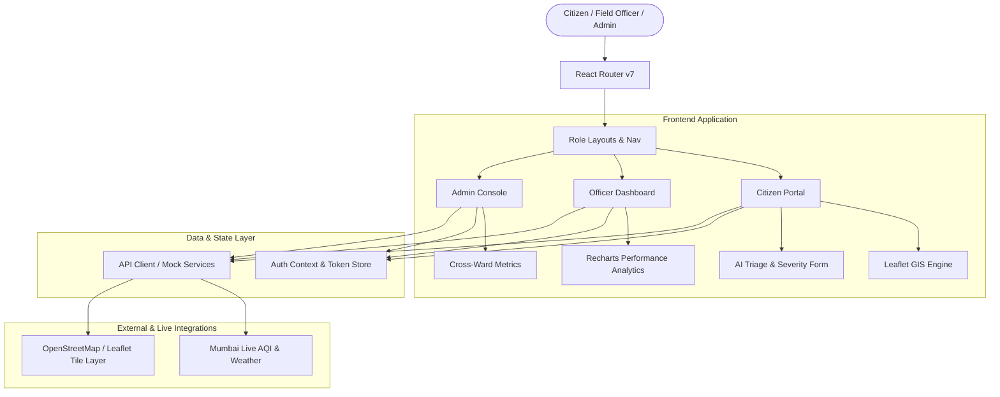

<div align="center">

# 🏛️ KAISER AI
### *AI-Powered Civic Grievance & Municipal Resolution Platform for Mumbai*

[](https://react.dev/)
[](https://vitejs.dev/)
[](https://tailwindcss.com/)
[](https://leafletjs.com/)
[](#license)

<p align="center">
  <b>Empowering Citizens. Streamlining Municipal Wards. Accelerating Resolution.</b><br />
  Built for Mumbai’s 24 Municipal Wards (BMC) with intelligent automated triage, live geospatial mapping, and role-tailored dashboards.
</p>

[Explore Features](#-key-features) • [Quick Start](#-quick-start) • [Role Portals](#-role-portals) • [Architecture](#-architecture) • [Demo Credentials](#-default-demo-credentials)

---

</div>

## 📌 Executive Summary

**Kaiser AI** is a next-generation municipal governance platform engineered to bridge the gap between citizens and urban municipal bodies (Brihanmumbai Municipal Corporation - BMC). 

By leveraging **AI classification**, **severity scoring**, and **geospatial routing**, Kaiser AI eliminates manual triage bottlenecks and automatically directs citizen grievances—ranging from severe road potholes to dangerous open drainage and streetlight failures—directly to the responsible ward engineers with time-bound SLA tracking.

---

## 🌟 Key Features

### 👤 1. Citizen Portal (`/app`)
- **Smart Grievance Filing**: AI-assisted complaint registration with auto-categorization and severity prediction (0–100 scale).
- **Interactive Live Map**: Leaflet-powered GIS map visualizing verified civic issues, colored by severity and category pins across Mumbai.
- **My Complaints Tracker**: Track resolution milestones in real time (`Submitted` ➔ `Assigned` ➔ `In Progress` ➔ `Resolved`).
- **Live Environmental Barometer**: Real-time ambient weather, humidity, and Mumbai AQI integration to contextualize seasonal civic hazards like monsoon waterlogging.

### 👷 2. Ward Officer Portal (`/officer`)
- **Triage & Dispatch Desk**: Filter grievances by municipal ward (e.g., K/E Andheri, G/N Bandra, Worli) and priority level.
- **Workflow State Management**: One-click actions to acknowledge, schedule, update status, and close complaints with resolution notes.
- **Performance & SLA Monitoring**: Live tracking of average turnaround time, overdue violations, and target resolution quotas.
- **Visual Analytics**: Interactive Recharts breakdown of complaint categories and weekly resolution throughput.

### 🏛️ 3. City Administrator Console (`/admin`)
- **BMC Command Center**: Macro-level view of grievance inflow across all 24 Mumbai wards.
- **Ward Performance Heatmaps**: Comparative analytics highlighting top-performing wards and zones lagging behind SLAs.
- **Officer & Resource Roster**: Manage field officers, reallocate workloads, and audit departmental bottlenecks.
- **One-Click Audit Reports**: Export summary metrics for municipal executive briefings.

---

## 🏗️ Architecture & Tech Stack



| Layer | Technology | Purpose |
| :--- | :--- | :--- |
| **Framework** | **React 19** + **Vite 8** | Ultra-fast client-side SPA with lightning HMR |
| **Styling** | **Tailwind CSS v4** | Modern design system, custom palettes, glassmorphism |
| **Icons** | **Lucide React** | Clean, consistent SVG iconography |
| **Mapping** | **Leaflet** + **React-Leaflet** | Interactive geospatial issue clustering & ward mapping |
| **Charts** | **Recharts** | Smooth SVG-based data visualizations and KPI trends |
| **Routing** | **React Router v7** | Client routing with multi-tier nested layouts |
| **Forms & Validation** | **React Hook Form** + **Zod** | Type-safe form handling and validation |
| **Alerts & Toasts** | **React Hot Toast** | Non-intrusive feedback notifications |

---

## 🚀 Quick Start

### Option A: Unified Docker Deployment (Recommended)
Launch the complete platform with PostgreSQL 16 + PostGIS, Redis, Python FastAPI, YOLOv8 vision engine, and compiled React SPA in one command:
```bash
docker compose up -d --build
```
- Web Application & API: `http://localhost:5000`
- API Documentation (Swagger): `http://localhost:5000/docs`
- PostGIS Database: `localhost:5432`

---

### Option B: Local Development

#### 1. Frontend Setup
```bash
npm install
npm run dev
```
Spins up the Vite development server at `http://localhost:5173`.

#### 2. Unified Python FastAPI & AI Backend
```bash
# Install backend dependencies
pip install -r backend/requirements.txt

# Run unified backend (Auth + Grievance + Wards + YOLOv8 + PostGIS/SQLite)
python backend/app.py
```
Backend runs on `http://localhost:5000`.

#### 3. Run Automated End-to-End Validation
```bash
python backend/test_e2e.py
```

---

## 🔑 Default Demo Credentials

For quick local evaluation without setting up an external backend database, use the pre-configured role presets:

| Role | Preset Email | Password | Assigned Scope | Portal |
| :--- | :--- | :--- | :--- | :--- |
| **Citizen (Demo)** | `priya.nair@example.com` | `Citizen@123` | Individual Submissions & Ward 8 | `/login` |
| **Ward Officer** | `suresh.patil@bmc.gov.in` | `BandraN@2024` | G/N Ward (Bandra North) Field Desk | `/officer-login` |
| **BMC Administrator** | `r.mehta@bmc.gov.in` | `Admin@2024` | Municipal Commissioner (All 24 Wards) | `/officer-login` |

*(Citizens log in at `/login`. Ward Officers & Municipal Administrators log in via the official staff gateway at `/officer-login`)*

---

## 📁 Project Structure

```
Hikari/
├── public/                  # Static assets & favicon
├── src/
│   ├── api/                 # API service clients & mock data endpoints
│   │   ├── analytics.api.js # City & ward statistics
│   │   ├── auth.api.js      # Authentication & Google OAuth
│   │   ├── complaints.api.js# Grievance CRUD & GIS coordinates
│   │   └── weather.api.js   # AQI and meteorology feeds
│   ├── components/
│   │   ├── common/          # Reusable UI primitives (Button, Card, Badge, Modal, Input)
│   │   ├── complaints/      # Grievance cards, status pills, category icons
│   │   ├── layout/          # Public, Citizen, Officer, and Admin shell layouts
│   │   └── map/             # Leaflet mapping components and markers
│   ├── context/
│   │   └── AuthContext.jsx  # Global session, JWT restore, and role switching
│   ├── pages/
│   │   ├── LandingPage.jsx  # Public marketing hero, live ticker & emergency hotline
│   │   ├── AuthPage.jsx     # Multi-role authentication & registration
│   │   ├── CitizenPages.jsx # Citizen dashboard, report form, my complaints, map
│   │   ├── OfficerPages.jsx # Ward triage queue & officer KPIs
│   │   └── AdminPages.jsx   # City-wide macro analytics & ward leaderboards
│   ├── utils/
│   │   ├── formatters.js    # Date, time, currency, and string sanitizers
│   │   └── mockData/        # Seed datasets for complaints, wards, and officers
│   ├── App.jsx              # Application route tree
│   └── main.jsx             # React DOM root entry
├── package.json
├── tailwind.config.js
└── vite.config.js
```

---

## 🛣️ Features & Roadmap

- [x] **Multilingual Support (Marathi, Hindi, English)**: Complete UI localization across portals with persistent preference.
- [x] **Live Notifications Center & Drawer**: Interactive notifications panel with unread badges, mark-as-read, and real-time grievance dispatch alerts.
- [x] **GPS Auto-Locate & Draggable Pin Map**: Device geolocation, OpenStreetMap reverse-geocoding, nearest municipal ward auto-detection, and interactive Leaflet pin picker.
- [x] **Spatial Deduplication & Geo-clustering (DBSCAN)**: Geodesic clustering within 25m to detect duplicate grievances and merge them into upvotes.
- [x] **Citizen "Me Too" Upvoting & Karma Economy**: Prevents ticket flooding, rewards citizens with Karma points redeemable for transit and municipal vouchers.
- [x] **Field Inspection & Before/After Verification**: Interactive before/after evidence slider, 200m physical GPS geofence telemetry, and material expenditure ledger.
- [x] **Tamper-Proof Web Crypto SHA-256 Seal**: Cryptographically signed resolution certificates with immutable audit hashes for field closures.
- [x] **Kaiser Sahayak AI Assistant**: 24/7 conversational municipal assistant powered by Gemini 1.5 Flash with trilingual BMC routing.
- [ ] **WhatsApp Grievance Bot Integration** for zero-friction reporting on mobile.

---

## 📄 License

This project is licensed under the [MIT License](LICENSE).
