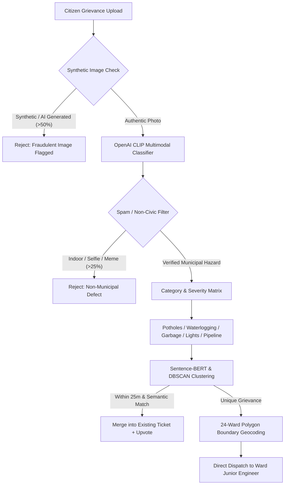
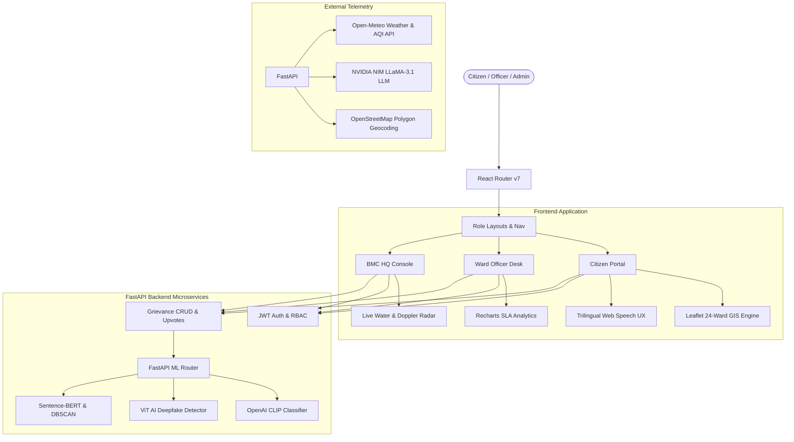

<div align="center">

# 🏛️ KAISER AI
### *Next-Generation Sovereign Civic Intelligence & Municipal Governance Platform for Mumbai*

[](https://react.dev/)
[](https://vitejs.dev/)
[](https://tailwindcss.com/)
[](https://fastapi.tiangolo.com/)
[](https://pytorch.org/)
[](https://huggingface.co/openai/clip-vit-base-patch32)
[](https://leafletjs.com/)
[](#license)

<p align="center">
  <b>Sovereign AI-driven civic issue reporting, automated multi-modal triage, and real-time municipal telemetry across all 24 BMC administrative zones in Greater Mumbai.</b>
</p>

[Key Features](#-key-features) • [AI & ML Intelligence Suite](#-ai--ml-intelligence-suite) • [Architecture](#-architecture--tech-stack) • [Quick Start](#-quick-start) • [Role Portals & Credentials](#-default-demo-credentials) • [Engineering Team](#-engineering-core--contributors)

---

</div>

## 📌 Executive Summary

**Kaiser AI** is an advanced municipal command and governance platform engineered to eliminate triage bottlenecks between citizens and the Brihanmumbai Municipal Corporation (BMC).

Traditional municipal complaint channels rely on manual sorting, paper registers, and congested helplines that delay action by days. Kaiser AI introduces a **3-tier multimodal artificial intelligence stack**:
1. **Zero-Shot Multimodal Visual Defect Classifier** powered by **OpenAI CLIP** to identify municipal hazards and reject non-civic spam.
2. **Deep Learning Synthetic Image Detector** (Vision Transformer / ViT) to intercept AI-generated or spoofed image uploads.
3. **Spatial Deduplication & Semantic NLP Engine** (Sentence-BERT + DBSCAN) to aggregate nearby reports into citizen upvotes.
4. **Sub-Meter 24-Ward Polygon Reverse-Geocoding** to automatically route tickets directly to the responsible Assistant Commissioner and Junior Ward Engineers.

---

## 🌟 Key Features

### 👤 1. Citizen Portal (`/app`)
- **Zero-Touch Multimodal Reporting**: Upload photos with real-time AI category detection and 1–100 severity risk scoring.
- **Trilingual Voice Grievance Engine**: In-browser speech recognition supporting conversational Marathi, Hindi, and English.
- **Interactive 24-Ward GIS Map**: Cluster-based Leaflet map visualizing grievances, flood hotspots, and real-time status pins.
- **"Me Too" Citizen Upvoting & Karma Economy**: Prevents duplicate tickets while rewarding active civic champions with municipal Karma points.
- **Tamper-Proof Resolution Verification**: Interactive before/after photo slider and cryptographically verifiable SHA-256 completion certificate.

### 👷 2. Ward Officer Portal (`/officer`)
- **Real-Time Triage & Dispatch Queue**: Filter by administrative zone (A Ward Colaba to T Ward Mulund) and emergency priority.
- **Field Inspection Protocols**: 200m physical GPS geofence validation, material expenditure ledger, and after-repair photo uploads.
- **Performance & SLA Monitoring**: Turnaround tracking, automated escalation alerts, and resolution quota metrics.
- **Enforced Operational Dark Console**: High-contrast, distraction-free command environment designed for field responsiveness.

### 🏛️ 3. Municipal Headquarters Command Center (`/admin`)
- **City-Wide Macro Telemetry**: Real-time aggregated ticket inflow, resolution velocity, and ward rankings across all 24 BMC zones.
- **IMD Doppler Radar & Flood Telemetry**: Live dewatering sump status (Mithi River, Sion, Hindmata) and Arabian Sea tidal watches.
- **Officer Roster & Workload Rebalancer**: Dynamic cross-ward task reallocation and departmental bottleneck auditing.
- **Official Executive Briefings**: One-click PDF audit generation and municipal compliance reporting.

---

## 🧠 AI & ML Intelligence Suite

Kaiser AI replaces legacy brittle computer vision models with modern multimodal foundation models:



### 1. OpenAI CLIP Zero-Shot Multimodal Classifier (`clip_service.py`)
- **Architecture**: OpenAI CLIP `ViT-B/32` transformer.
- **Capability**: Matches image embeddings against engineered prompt ensembles for municipal hazards (`potholes`, `waterlogging`, `overflowing garbage`, `broken streetlights`, `pipeline burst`).
- **Spam Filtering**: Dynamically detects and rejects selfies, indoor furniture, food, documents, and internet memes with sub-second inference.

### 2. ViT Deep Learning Synthetic AI Detector (`authenticity_service.py`)
- **Architecture**: Vision Transformer (`umm-maybe/AI-image-detector`).
- **Capability**: Detects synthetic artifacts from generative models (Midjourney, Stable Diffusion, DALL-E) to guarantee evidence authenticity before civic dispatch.

### 3. Spatial Deduplication & Semantic NLP (`duplicate_service.py`)
- **Architecture**: `Sentence-BERT` semantic embeddings combined with `DBSCAN` (Haversine 25-meter radius).
- **Capability**: Groups simultaneous complaints of the same road pothole or overflowing sump into a single master ticket, incrementing citizen upvote counts automatically.

### 4. Conversational Civic AI Assistant (`CivicAiAssistant.jsx`)
- **Integration**: NVIDIA NIM API (`meta/llama-3.1-70b-instruct`) with trilingual prompt orchestration for municipal regulations, Lokshahi Din timings, and disaster guidance.

---

## 🏗️ Architecture & Tech Stack



| Domain | Technology | Description |
| :--- | :--- | :--- |
| **Frontend Framework** | **React 19** + **Vite 8** | Client-side SPA with sub-second Hot Module Replacement |
| **Styling & Design** | **Tailwind CSS v4** | Adaptive theme tokens, glassmorphism, responsive grid architecture |
| **State & Navigation** | **React Router v7** | Role-gated portal shells with persistent route restoration |
| **Geospatial & Mapping** | **Leaflet** + **React-Leaflet** | Sub-meter polygon reverse geocoding across 24 BMC wards |
| **Visual Analytics** | **Recharts** | Reactive SVG charts, ward leaderboards, and SLA throughput curves |
| **Backend Framework** | **FastAPI (Python 3.11+)** | Asynchronous REST microservices with Pydantic v2 schemas |
| **Database Engine** | **SQLite WAL** / **PostgreSQL** | High-concurrency Write-Ahead Logging with ACID integrity |
| **Vision Foundation** | **OpenAI CLIP ViT-B/32** | Zero-shot visual defect classification & spam rejection |
| **Image Authenticity** | **Hugging Face ViT** | Deepfake and generative AI image detection |
| **NLP & Clustering** | **Sentence-BERT + DBSCAN** | Semantic embedding similarity with 25m spatial radius grouping |
| **Voice & Speech** | **Web Speech Recognition API** | Trilingual voice dictation (Marathi, Hindi, English) |

---

## 🚀 Quick Start

### 1. Prerequisites
- **Node.js**: v18.0.0 or higher
- **Python**: v3.11 or higher
- **Git**

### 2. Frontend Setup
```bash
# Navigate to the repository root
cd "Hikari version 2/Hikari-main version 2"

# Install frontend dependencies
npm install

# Start Vite dev server
npm run dev
```
> The frontend will launch at `http://localhost:5173`.

### 3. Backend Setup
```bash
# Navigate to backend directory
cd backend

# Install Python requirements
pip install -r requirements.txt

# Start FastAPI server
python app.py
```
> The backend will launch at `http://localhost:5000` with interactive API docs at `http://localhost:5000/docs`.

### 4. Running Verification Test Suite
```bash
cd backend
python test_regression.py
```
> Runs the complete 18-suite regression suite validating zero-shot CLIP, AI image authentication, RBAC certificates, and concurrent upvote integrity.

---

## 🔑 Default Demo Credentials

Pre-configured role credentials for instant evaluation across all municipal access levels:

| Role | Email | Password | Assigned Scope | Portal Gateway |
| :--- | :--- | :--- | :--- | :--- |
| **Citizen** | `priya.nair@example.com` | `Citizen@123` | Colaba & Bandra Citizen Account | `/login` |
| **Ward Officer** | `suresh.patil@bmc.gov.in` | `BandraN@2024` | Ward G/North (Bandra / Dharavi) | `/officer/login` |
| **HQ Administrator** | `r.mehta@bmc.gov.in` | `Admin@2024` | Municipal Commissioner (All 24 Wards) | `/officer/login` |

---

## 👥 Engineering Core & Contributors

<div align="center">

### The Minds Behind Kaiser AI
*A collaborative effort uniting computer vision research, full-stack systems engineering, and municipal governance insights.*

</div>

| Contributor | Role & Domain | Key Architectural Contributions |
| :--- | :--- | :--- |
| **Ayush Barve** | **Chief AI Architect & Principal Systems Lead**<br />*Vision-Language Transformers, Autonomous NLP & Scalable Backend* | • **Pioneered the Core AI Intelligence Stack**: Architected and tuned the 3-tier deep learning suite featuring zero-shot OpenAI CLIP multimodal hazard recognition with sub-second spam rejection, high-throughput ViT deepfake authenticity verification, and Sentence-BERT + DBSCAN spatial deduplication.<br />• **High-Performance Backend Engineering**: Designed the asynchronous FastAPI microservices architecture, SQLite WAL high-concurrency transaction handling with race-condition rollbacks, automated SLA breach escalation algorithms, and production-grade municipal resilience. |
| **Dharmik Desai** | **Frontend Architect & Geospatial Systems Lead**<br />*Interactive GIS & Multilingual Voice UX* | • **Geospatial 24-Ward Mapping**: Engineered the interactive Leaflet GIS mapping engine with sub-meter polygon point-in-polygon reverse-geocoding across all 24 BMC zones.<br />• **Accessible Voice UX**: Built the in-browser Web Speech voice grievance recording engine supporting natural conversational Marathi, Hindi, and English.<br />• **Responsive UI Architecture**: Developed modern responsive component architecture, interactive Before/After evidence sliders, and tactile municipal dashboard telemetry. |
| **Harsh Mane** | **Cloud API & Systems Integration Lead**<br />*Municipal APIs & Multi-Portal Architecture* | • **External Telemetry & Cloud APIs**: Architected integrations for the NVIDIA NIM civic LLM assistant, real-time Open-Meteo weather and AQI monitoring, and IMD Doppler radar feeds.<br />• **Multi-Portal UX Engineering**: Engineered the comprehensive Citizen, Ward Officer, and Municipal HQ portal interfaces with enforced dark command aesthetics.<br />• **Municipal Dataset Research**: Conducted foundational research to source, structure, and validate high-precision municipal datasets, officer rosters, and SLA benchmark schemas across all 24 BMC zones. |

---

## 📄 License

This project is licensed under the [MIT License](LICENSE).
