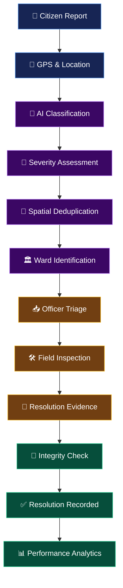
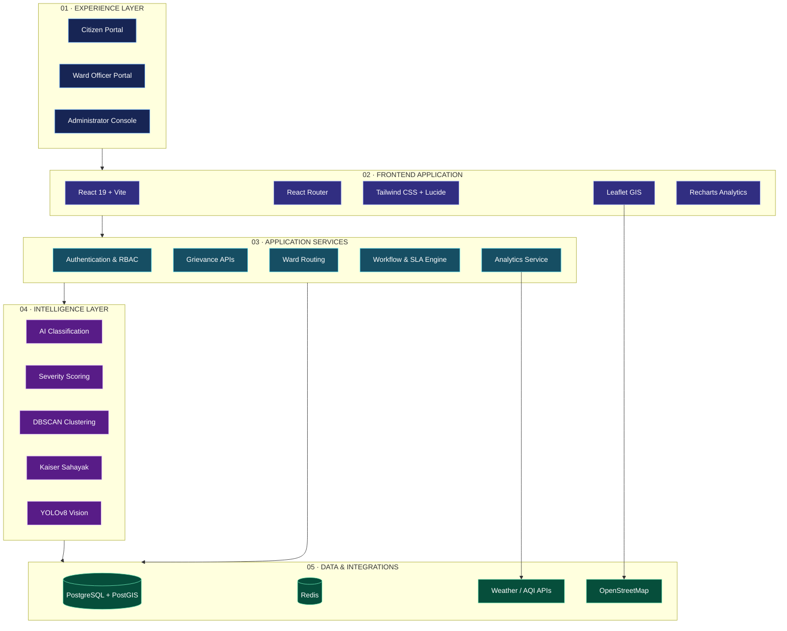

<!--
  KAISER AI — CINEMATIC GITHUB README
  Product: AI-Powered Civic Grievance & Municipal Resolution Platform
  Design: Midnight Navy · Electric Violet · Cyan · Mumbai Civic Intelligence
-->

<div align="center">

<a href="#-kaiser-ai">

</a>

<br/>


<br/>

<p>
  
  
  
  
</p>

**A smarter connection between citizens, municipal officers, and the city they serve.**

AI-assisted grievance intelligence · Geospatial issue mapping · Ward operations · Evidence-aware resolution

<br/>

[🚀 Explore Platform](#-platform-experience) · [✨ Features](#-next-generation-capabilities) · [🏗️ Architecture](#-intelligence-architecture) · [⚡ Quick Start](#-launch-kaiser-ai) · [🗺️ Roadmap](#-the-evolution)

<br/>


</div>

<a id="-kaiser-ai"></a>

## ◈ 01 — The Vision

**KAISER AI** is an AI-powered civic grievance and municipal resolution platform designed to help Mumbai move toward more transparent, responsive, and data-driven civic services.

Road potholes. Overflowing drainage. Broken streetlights. Waterlogging. Sanitation issues.

Every unresolved civic issue affects someone's everyday life.

KAISER AI brings reporting, intelligent prioritization, geographic routing, officer workflows, and resolution tracking into one connected digital experience.

<table>
<tr>
<td align="center" width="25%">


**Citizen Voice**

</td>
<td align="center" width="25%">


**AI Intelligence**

</td>
<td align="center" width="25%">


**Ward Operations**

</td>
<td align="center" width="25%">


**Accountability**

</td>
</tr>
</table>

> **Our principle:** Technology should not make civic governance more complicated. It should make reporting easier, decisions more informed, and outcomes more visible.

---

## ◈ 02 — Platform Experience

<div align="center">


</div>

<table>
<tr>
<td width="50%" valign="top">

### 

#### Your city. Your voice.

- Smart grievance registration
- AI-assisted complaint classification
- GPS location and draggable map pin
- Severity prediction and priority indicators
- Interactive civic issue map
- Personal complaint timeline
- Live notification center
- Multilingual interface
- Community upvoting and duplicate discovery

**Experience:** `/app`

</td>
<td width="50%" valign="top">

### 

#### Every issue has an owner.

- Ward-specific grievance queues
- Priority-based complaint filtering
- Assignment and dispatch workflows
- Inspection and resolution notes
- Before-and-after evidence capture
- SLA monitoring and overdue tracking
- Resolution throughput analytics
- Officer workload visibility

**Experience:** `/officer`

</td>
</tr>
<tr>
<td width="50%" valign="top">

### 

#### A city-wide perspective.

- City-wide grievance overview
- Ward performance comparisons
- Geographic hotspot analytics
- Officer and resource management
- Departmental bottleneck analysis
- Resolution-time reporting
- Executive audit summaries

**Experience:** `/admin`

</td>
<td width="50%" valign="top">

### 

#### Conversational civic assistance.

- English, Hindi, and Marathi support
- Guidance on complaint registration
- Assistance with municipal workflows
- Natural-language civic queries
- AI-assisted service discovery
- Context-aware reporting guidance

**Engine:** Gemini API integration

</td>
</tr>
</table>

---

## ◈ 03 — Next-Generation Capabilities

### 01. AI Grievance Intelligence


Transform unstructured citizen reports into actionable information.

- Natural-language complaint classification
- Severity estimation on a 0–100 scale
- Suggested complaint categories
- Potential department and ward recommendations
- Confidence-aware review workflows
- Human oversight for uncertain predictions

### 02. Geospatial Intelligence


Give every complaint geographic context.

- GPS-assisted location selection
- Leaflet-powered interactive maps
- OpenStreetMap geographic visualization
- Ward boundary matching
- DBSCAN-based spatial clustering
- Configurable duplicate-detection radius
- Civic hotspot identification

### 03. Evidence-Aware Resolution


Make the resolution process more accountable.

- Before-and-after image comparison
- Inspection timestamps
- Configurable GPS proximity verification
- Field notes and expenditure records
- SHA-256 evidence integrity hashes
- Auditable complaint status changes

*Cryptographic hashes help detect modifications to recorded data; they do not independently prove that a photograph or inspection is genuine.*

### 04. Environmental Context


Connect civic issues with relevant environmental conditions.

- Weather and humidity information
- Mumbai air-quality information
- Monsoon-related issue context
- Potential geographic risk patterns
- Time-based civic trend analysis

Live data requires valid, configured external service integrations.

### 05. Community-Powered Reporting


- Community support for existing complaints
- Duplicate submission discovery
- Geographic issue clustering
- Recurring problem identification
- Configurable anti-spam controls

---

## ◈ 04 — The Animated Intelligence Pipeline

<div align="center">


</div>



| Stage | Responsibility |
|---|---|
| **CAPTURE** | Collect a citizen's complaint and location |
| **UNDERSTAND** | Classify the issue and estimate its severity |
| **PRIORITIZE** | Identify urgency and potential duplicates |
| **ROUTE** | Identify the appropriate municipal workflow |
| **INSPECT** | Record field actions and evidence |
| **VERIFY** | Maintain an auditable resolution record |
| **MEASURE** | Analyze service delivery and SLA performance |

---

## ◈ 05 — Intelligence Architecture

<div align="center">


</div>



### Technology Matrix

| Layer | Technology | Purpose |
|---|---|---|
| UI | React 19, Vite 8 | Interactive web application |
| Styling | Tailwind CSS v4 | Responsive visual system |
| Routing | React Router v7 | Multi-portal navigation |
| Mapping | Leaflet, React-Leaflet | Geographic issue visualization |
| Analytics | Recharts | Operational charts and trends |
| Validation | React Hook Form, Zod | Form state and validation |
| Backend | Python, FastAPI | API and business logic |
| Database | PostgreSQL, PostGIS | Persistent and spatial data |
| Caching | Redis | Optional caching and background workflows |
| Vision | YOLOv8 | Optional image-based analysis |
| Assistant | Gemini API | Conversational assistance |
| Maps | OpenStreetMap | Geographic map data |
| Deployment | Docker Compose | Multi-service deployment |

*The architecture shows the intended system design. Each service must be configured, connected, and tested before being considered production-ready.*

---

## ◈ 06 — Launch KAISER AI

<div align="center">


</div>

### Prerequisites

- Node.js and npm
- Python compatible with backend dependencies
- Docker Desktop for containerized deployment
- PostgreSQL/PostGIS and Redis if required by the selected configuration
- Valid environment variables and external API credentials

### Option A — Docker Compose

From the repository root:

```bash
docker compose up -d --build
```

Inspect the services:

```bash
docker compose ps
```

Follow application logs:

```bash
docker compose logs -f
```

Stop the environment:

```bash
docker compose down
```

Expected local endpoints, subject to your Docker configuration:

| Component | Address |
|---|---|
| Web application / API gateway | `http://localhost:5000` |
| FastAPI documentation | `http://localhost:5000/docs` |
| PostgreSQL / PostGIS | `localhost:5432` |

### Option B — Local development

**1. Start the frontend**

```bash
npm install
npm run dev
```

Open `http://localhost:5173`.

**2. Create a Python environment**

```bash
python -m venv .venv
```

Windows PowerShell:

```powershell
.\.venv\Scripts\Activate.ps1
pip install -r backend/requirements.txt
```

**3. Start the backend**

```bash
python backend/app.py
```

Open `http://localhost:5000/docs` if the backend serves its API documentation there.

**4. Run the end-to-end test script**

```bash
python backend/test_e2e.py
```

These commands assume the named files and scripts exist in your current repository. Configure database connections, API keys, and frontend/backend URLs before starting the services.

---

## ◈ 07 — Role Portals & Demo Credentials

| Role | Login route | Scope |
|---|---|---|
| Citizen | `/login` | Personal reporting and complaint tracking |
| Ward Officer | `/officer-login` | Assigned ward operations |
| Administrator | `/officer-login` | City-wide administration |

### Demo accounts

The following are the example credentials provided for the project's demo presets. They work only if the accounts have been seeded and the authentication service supports them.

| Role | Email | Password |
|---|---|---|
| Citizen | `priya.nair@example.com` | `Citizen@123` |
| Ward Officer | `suresh.patil@bmc.gov.in` | `BandraN@2024` |
| Administrator | `r.mehta@bmc.gov.in` | `Admin@2024` |

> **Security:** These are demonstration credentials, not production accounts. Replace them before deployment. Enforce server-side role permissions, secure password hashing, input validation, and proper secret management.

---

## ◈ 08 — Repository Structure

```text
Hikari/
├── public/
├── src/
│   ├── api/
│   │   ├── analytics.api.js
│   │   ├── auth.api.js
│   │   ├── complaints.api.js
│   │   └── weather.api.js
│   ├── components/
│   │   ├── common/
│   │   ├── complaints/
│   │   ├── layout/
│   │   └── map/
│   ├── context/
│   │   └── AuthContext.jsx
│   ├── pages/
│   │   ├── LandingPage.jsx
│   │   ├── AuthPage.jsx
│   │   ├── CitizenPages.jsx
│   │   ├── OfficerPages.jsx
│   │   └── AdminPages.jsx
│   ├── utils/
│   │   ├── formatters.js
│   │   └── mockData/
│   ├── App.jsx
│   └── main.jsx
├── backend/
│   ├── app.py
│   ├── requirements.txt
│   └── test_e2e.py
├── docker-compose.yml
├── package.json
├── tailwind.config.js
└── vite.config.js
```

*Adapt this tree to the actual repository. The backend and Docker files shown here are expected locations, not a guarantee that every file exists.*

---

## ◈ 09 — The Evolution

<div align="center">


</div>

### Implemented features

- [x] Multilingual interface
- [x] Interactive grievance map
- [x] GPS-assisted location selection
- [x] Complaint status workflows
- [x] Notification center
- [x] Spatial deduplication
- [x] Community upvoting
- [x] Field evidence workflow
- [x] SHA-256 evidence integrity fingerprints
- [x] Conversational municipal assistant

### Future enhancements

- [ ] WhatsApp grievance bot
- [ ] Automated SLA escalation
- [ ] Advanced civic hotspot forecasting
- [ ] Resolution satisfaction analytics
- [ ] Improved accessibility and assisted reporting
- [ ] Production observability and alerting
- [ ] Security assessment and load testing
- [ ] Expanded model evaluation and multilingual testing

*Keep completed items aligned with functionality that has actually been implemented and tested.*

---

## ◈ 10 — Security, Privacy & Responsible AI

KAISER AI should be designed around public trust.

- **Privacy first:** Minimize collection of personal information and sensitive location data.
- **Explainable decisions:** Provide understandable reasons for suggested priorities.
- **Human oversight:** Let municipal staff review uncertain classifications.
- **Secure authentication:** Enforce permissions on the backend.
- **Evidence integrity:** Maintain timestamps, audit events, and cryptographic hashes.
- **Abuse prevention:** Protect reporting and upvoting from spam and manipulation.
- **Reliable operations:** Monitor service failures and protect external API credentials.
- **Responsible AI:** Test model accuracy across languages and grievance categories.

AI predictions should assist municipal teams, not independently determine whether a citizen receives essential civic services.

---

## ◈ 11 — Why KAISER AI?

| Traditional civic workflows | KAISER AI approach |
|---|---|
| Manual complaint categorization | AI-assisted classification |
| Fragmented issue records | Geographic complaint context |
| Limited status visibility | Structured status tracking |
| Inconsistent field evidence | Evidence-aware resolution |
| Delayed performance reporting | Ward-level analytics |
| Difficult audit trails | Timestamped events and integrity hashes |

**The goal is not merely to digitize complaints. It is to build a connected system that makes civic service delivery more transparent, measurable, and responsive.**

---

## ◈ 12 — Contributing

Contributions that improve accessibility, geospatial accuracy, AI reliability, security, and municipal workflow design are welcome.

1. Fork the repository.
2. Create a feature branch.
3. Implement and test your changes.
4. Submit a pull request with a clear description.
5. Include screenshots or recordings for UI changes.

## ◈ 13 — License

Distributed under the MIT License. See [`LICENSE`](LICENSE) for the complete terms.

---

<div align="center">

<a href="https://capsule-render.vercel.app/api?type=waving&height=200&color=0:06B6D4,50:4338CA,100:070B19&section=footer&text=KAISER%20AI&fontSize=54&fontColor=FFFFFF&animation=fadeIn&fontAlignY=45&desc=THE%20CITY%20DESERVES%20BETTER.&descSize=15&descAlignY=70">

</a>


**KAISER AI** · Civic Intelligence for a Better Mumbai

<sub>One connected platform. A more accountable civic future.</sub>

</div>
